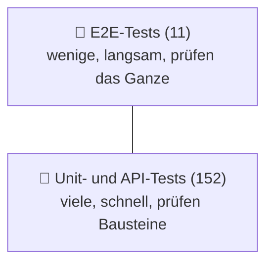
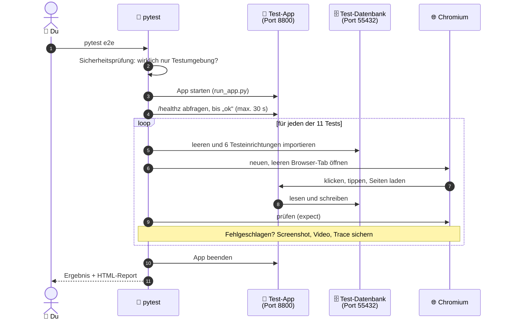
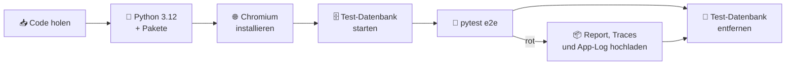

# E2E-Tests – der Testkunde in unserer Übungsfiliale

Diese Seite erklärt, was die End-to-End-Tests (kurz **E2E-Tests**) im
Pflegezentren-Finder prüfen, wie sie funktionieren und wie man sie selbst
startet. Sie richtet sich an alle im Team, auch ohne Testerfahrung. Python-
Grundkenntnisse reichen. Fachbegriffe werden beim ersten Auftauchen erklärt
und stehen gesammelt im [Glossar](#13-glossar).

## Inhalt

1. [E2E-Tests in einem Bild](#1-e2e-tests-in-einem-bild)
2. [Warum E2E-Tests?](#2-warum-e2e-tests)
3. [Was genau geprüft wird](#3-was-genau-geprüft-wird)
4. [Wie ein Testlauf abläuft](#4-wie-ein-testlauf-abläuft)
5. [Die Testdaten](#5-die-testdaten)
6. [Nie gegen echte Daten](#6-nie-gegen-echte-daten)
7. [Die Dateien in diesem Ordner](#7-die-dateien-in-diesem-ordner)
8. [Tests lokal ausführen](#8-tests-lokal-ausführen)
9. [Tests in GitHub Actions](#9-tests-in-github-actions)
10. [Wenn ein Test rot ist](#10-wenn-ein-test-rot-ist)
11. [Einen neuen Test schreiben](#11-einen-neuen-test-schreiben)
12. [Grenzen und Ausblick](#12-grenzen-und-ausblick)
13. [Glossar](#13-glossar)

---

## 1. E2E-Tests in einem Bild

Stell dir unsere App als **Geschäft** vor. Bevor ein neues Regal oder eine neue
Kasse in den echten Laden kommt, wird alles in einer **Übungsfiliale** von einem
**Testkunden** ausprobiert.

| In der Übungsfiliale | Bei uns |
|---|---|
| 🤖 Ein **Testkunde** geht durch den Laden, klickt, tippt und schaut genau hin | **Playwright** steuert einen echten Browser (**Chromium**) |
| 🏬 Er kauft nur in der **Übungsfiliale**, nie im echten Laden | Eine eigene Test-App auf `http://127.0.0.1:8800` mit eigener Test-Datenbank |
| 📦 Im Regal liegt **Musterware**, keine echte Ware | 6 erfundene Einrichtungen aus `data/centers.csv` |
| 🔄 Vor **jedem** Kunden wird das Regal genau gleich eingeräumt | Vor jedem Test wird die Datenbank geleert und neu befüllt |
| 📋 Der Kunde hat eine **Checkliste**: „Finde ich Leipzig? Kann ich eine Mail vorbereiten?“ | Die Testdateien `test_*.py` |
| 🔒 Die Tür der Übungsfiliale **geht nur auf, wenn es wirklich die Übungsfiliale ist** | Eine Sicherheitsprüfung bricht ab, sobald etwas nach echten Daten aussieht (Abschnitt 6) |
| 📹 Läuft etwas schief, zeichnet eine **Kamera** alles auf | Screenshot, Video und Trace bei jedem fehlgeschlagenen Test |
| 🧾 Am Ende gibt es ein **Prüfprotokoll** | HTML-Report unter `playwright-report/index.html` |

Der Testkunde ist schnell und nie müde: Alle 11 Tests laufen in wenigen Minuten
ab, lokal auf dem eigenen Rechner und automatisch bei jedem Pull Request.

---

## 2. Warum E2E-Tests?

Im Projekt gibt es zwei Arten von automatischen Tests:

| | Unit- und API-Tests | E2E-Tests |
|---|---|---|
| **Ordner** | `tests/` | `e2e/` (dieser Ordner) |
| **Was wird geprüft?** | Einzelne Bausteine: Funktioniert eine Funktion, antwortet die API richtig? | Das Zusammenspiel von allem: Browser, Oberfläche (HTML/JavaScript), App, Datenbank |
| **Aus wessen Sicht?** | Aus Sicht des Programms | Aus Sicht einer Person, die die Seite bedient |
| **Anzahl** | 152 | 11 |
| **Geschwindigkeit** | Sekunden | wenige Minuten (Browser, App und Datenbank müssen laufen) |
| **Wann laufen sie?** | Bei jedem Pull Request und jedem Push auf `main` (`.github/workflows/deploy.yml`) | Bei Pull Requests und Pushes auf `main`, die App, Datenbank oder Tests ändern (Abschnitt 9) |

Ein Unit-Test merkt zum Beispiel, wenn die API eine falsche Zahl liefert. Er
merkt aber **nicht**, wenn ein Knopf in der Oberfläche nichts mehr tut, weil im
JavaScript ein Tippfehler steckt. Genau dafür gibt es E2E-Tests.

Man spricht von der **Testpyramide**: unten viele schnelle, kleine Tests, oben
wenige langsame Tests, die das Ganze prüfen.



---

## 3. Was genau geprüft wird

Jeder Test spielt eine kleine Geschichte durch, wie sie ein Mensch an der
Oberfläche erleben würde.

### `test_smoke.py` – Startet die App überhaupt?

| Test | Was der Testkunde tut | Was geprüft wird |
|---|---|---|
| `test_healthz` | Fragt die Adresse `/healthz` ab | Die App antwortet mit `{"status": "ok"}` |
| `test_start_page_loads_without_errors` | Öffnet die Startseite und klickt auf „Übersicht“ | Titel „Pflegezentren-Finder“, alle 6 Einrichtungen in der Liste, Menüpunkt „Einrichtungen“ markiert. Nach dem Klick: Übersicht sichtbar, Zähler zeigt 6, Adresse endet auf `#dashboard`. **Keine Fehler in der Browser-Konsole** |

Der Name „Smoke-Test“ kommt aus der Elektronik: Gerät einschalten, raucht es?
Wenn schon dieser Test scheitert, brauchen die anderen gar nicht erst zu laufen.

Die Prüfung auf Konsolenfehler ist wichtig, weil die App eine strenge
**Content Security Policy** (CSP, `app/security.py`) hat. Sie verbietet zum
Beispiel Skripte von fremden Seiten. Ein Verstoß taucht nur als Fehler in der
Browser-Konsole auf und würde sonst niemandem auffallen.

### `test_centers_search.py` – Suchen und Filtern

| Test | Was der Testkunde tut | Was geprüft wird |
|---|---|---|
| `test_search_by_city` | Sucht nach „Leipzig“ | Genau 1 Treffer: „E2E Angehörigenberatung Leipzig“ mit „04109 Leipzig“ |
| `test_filter_by_state_and_offer_then_reset` | Wählt Bundesland Bayern, dann Angebot Demenzberatung, dann „Filter zurücksetzen“ | Erst 3 Treffer (nur Bayern), dann 1 (München), danach wieder alle 6 |
| `test_search_without_hits_shows_empty_state` | Sucht nach „Gibt-es-nicht“ | Meldung „Keine Einrichtungen gefunden.“, keine Karte in der Liste |

### `test_email_selection.py` – Einrichtungen für eine Sammel-Mail auswählen

| Test | Was der Testkunde tut | Was geprüft wird |
|---|---|---|
| `test_selected_centers_become_email_recipients` | Kreuzt Dresden und München an, klickt in der Aktionsleiste „E-Mail vorbereiten“ und in der E-Mail-Zentrale ohne Betreff noch einmal „E-Mail vorbereiten“ | Chemnitz (ohne E-Mail-Adresse) lässt sich nicht ankreuzen. 2 ausgewählt. Im Empfängerfeld stehen genau die beiden Adressen. Ohne Betreff verweigert der Browser das Absenden, es wird nichts vorbereitet |
| `test_clearing_selection_hides_bulk_actions` | Klickt „Alle auf dieser Seite auswählen“ und danach „Auswahl aufheben“ | Erst 5 ausgewählt (nur Einrichtungen mit E-Mail-Adresse), danach ist die Aktionsleiste weg und der Empfängerzähler steht auf 0 |

Das eigentliche Öffnen des Mailprogramms wird bewusst **nicht** ausgelöst
(siehe Abschnitt 12).

### `test_centers_crud.py` – Datenpflege

„CRUD“ steht für **C**reate, **R**ead, **U**pdate, **D**elete: anlegen,
lesen, ändern, löschen.

| Test | Was der Testkunde tut | Was geprüft wird |
|---|---|---|
| `test_create_center` | Füllt das Formular „Einrichtung hinzufügen“ aus (Hamburg, Kennnummer 1000001) und speichert | Meldung „Einrichtung angelegt.“. Die Einrichtung ist wirklich in der Datenbank gespeichert (Abfrage über die API). Die Liste zeigt jetzt 7 Einrichtungen, die neue ist auffindbar |
| `test_edit_center` | Öffnet Nürnberg zum Bearbeiten und ändert den Namen | Ein Hinweis warnt, dass der Datensatz aus dem automatischen Import stammt (Kennnummer unter 1.000.000). Meldung „Änderungen gespeichert.“, neuer Name in der Liste |
| `test_deactivate_center` | Öffnet Augsburg, klickt „Einrichtung deaktivieren“ und bestätigt die Rückfrage | Meldung „Einrichtung deaktiviert.“. Liste und Übersicht zeigen nur noch 5, Augsburg ist verschwunden |
| `test_invalid_postcode_is_rejected_without_request` | Gibt die Postleitzahl „123“ ein und speichert | Meldung „Die Postleitzahl muss aus genau 5 Ziffern bestehen.“ Es wird **keine** Änderung an den Server geschickt |

---

## 4. Wie ein Testlauf abläuft

Gestartet wird alles mit einem einzigen Befehl: `pytest e2e`. Danach passiert
Folgendes:



Drei Begriffe helfen beim Verstehen:

- **Fixture:** Eine Vorbereitung, die pytest automatisch vor einem Test
  erledigt. Ein Test schreibt einfach `def test_x(page: Page)` und bekommt
  dadurch einen fertigen Browser-Tab. Unsere eigenen Fixtures stehen in
  `conftest.py`:

  | Fixture | Wann | Was es tut |
  |---|---|---|
  | `app_server` | einmal pro Lauf | Startet die Test-App und wartet, bis sie antwortet; am Ende wird sie beendet |
  | `reset_db` | vor **jedem** Test, automatisch | Leert die Test-Datenbank und importiert die 6 Testeinrichtungen neu |
  | `console_errors` | wenn ein Test es anfordert | Sammelt alle Fehler aus der Browser-Konsole |
  | `page` | für jeden Test | Kommt von *pytest-playwright*: ein frischer Browser-Tab ohne Cookies |

  Weil jeder Test mit derselben Datenbank und einem leeren Tab beginnt, sind
  die Tests **unabhängig voneinander**. Die Reihenfolge spielt keine Rolle.

- **`expect` wartet von selbst:** `expect(...).to_have_count(1)` prüft nicht
  nur einmal, sondern fragt bis zu 5 Sekunden lang immer wieder nach, bis die
  Bedingung stimmt. Darum braucht kein Test ein `sleep()`: Die Seite darf in
  Ruhe laden, und der Test ist trotzdem nicht langsamer als nötig.

- **Headless:** Normalerweise läuft Chromium **ohne sichtbares Fenster**. Zum
  Zuschauen gibt es `--headed` (Abschnitt 8).

---

## 5. Die Testdaten

In der Test-Datenbank liegen nie echte Einrichtungen, sondern immer dieselben
6 erfundenen aus `data/centers.csv`. Fachleute nennen so einen festen
Startbestand **Seed** (englisch für Saatgut).

| Kennnummer | Name | Bundesland | E-Mail | Angebot | Wird gebraucht für |
|---|---|---|---|---|---|
| 101 | E2E Pflegestützpunkt Dresden | Sachsen | ja | Pflegestützpunkt, Pflegeberatung | E-Mail-Auswahl |
| 102 | E2E Angehörigenberatung Leipzig | Sachsen | ja | Angehörigenberatung | Suche nach Ort |
| 103 | E2E Seniorenberatung Chemnitz | Sachsen | **nein** | Pflegeberatung | „ohne E-Mail nicht auswählbar“ |
| 104 | E2E Demenzberatung München | Bayern | ja | Demenzberatung | Filter, E-Mail-Auswahl |
| 105 | E2E Wohnberatung Nürnberg | Bayern | ja | Wohnberatung | Bearbeiten |
| 106 | E2E Betreuungsberatung Augsburg | Bayern | ja | Betreuungsberatung | Deaktivieren |

- Alle Adressen enden auf `@e2e.example.org`. Die Domain `example.org` ist für
  Beispiele reserviert, eine Mail dorthin kann also nie bei echten Menschen
  landen.
- Die Gesamtzahl steht nirgends fest im Code: `db_seed.py` zählt die Zeilen der
  CSV und stellt sie den Tests als `SEED_COUNT` bereit.
- **Gleicher Weg wie im Betrieb:** Die CSV wird mit genau dem Importskript
  eingespielt, das auch der wöchentliche Datenimport nutzt
  (`db/import_centers.sql`). So gibt es nur **eine** Import-Logik, und sie wird
  bei jedem E2E-Lauf nebenbei mitgetestet. Technisch ersetzt `db_seed.py` nur
  die eine Zeile, die die Datei liest (`\copy`), durch eine Variante, die die
  CSV direkt aus Python überträgt. Alles andere läuft unverändert.

> **Wer die CSV ändert, passt die Tests mit an.** Einige Tests verlassen sich
> auf ihren Inhalt, zum Beispiel „3 Einrichtungen in Bayern“ oder
> „5 mit E-Mail-Adresse“.

---

## 6. Nie gegen echte Daten

Die E2E-Tests legen an, ändern und deaktivieren Einrichtungen und leeren vor
jedem Test die Datenbank. Gegen die echte Datenbank wäre das verheerend. Darum
gibt es mehrere Schutzschichten, die unabhängig voneinander greifen:

| Schutz | Wo | Was er verhindert |
|---|---|---|
| **Eigenes Docker-Projekt** `pl2-hfh-e2e` | `docker-compose.e2e.yml` | Eigene Container und Netzwerke: der normale Stack und sein Datenvolume `app-db-data` werden nie berührt |
| **Daten nur im Arbeitsspeicher** (tmpfs) | `docker-compose.e2e.yml` | Nichts wird dauerhaft gespeichert; jeder Start beginnt mit einer leeren Datenbank |
| **Nur auf dem eigenen Rechner erreichbar** | `127.0.0.1:55432` | Niemand im Netzwerk kann auf die Test-Datenbank zugreifen |
| **Feste Testkonfiguration statt `.env`** | `docker-compose.e2e.yml`, `run_app.py` | Die Test-Datenbank liest keine `.env`. Die Test-App setzt alle wichtigen Werte selbst und überstimmt damit eine vorhandene `.env`, sodass sie nie mit Produktivwerten startet |
| **Datenbankname muss auf `_e2e` enden** | `run_app.py` | Ein Lauf gegen `pflegedb` (die echte Datenbank) bricht sofort ab |
| **Nur lokale Adressen** | `run_app.py` | Datenbank und App müssen auf `localhost` / `127.0.0.1` liegen, nie auf einem Server |
| **`ENVIRONMENT=production` stoppt alles** | `run_app.py` | Selbst wenn alles andere passt: im Produktivmodus kein Testlauf |
| **Prüfung vor dem ersten Test** | `conftest.py` | Die Sicherheitsprüfung läuft, bevor irgendetwas gestartet oder gelöscht wird |
| **Gleiche Datenbank-Version wie produktiv** | `tests/test_e2e_compose.py` | Ein normaler Unit-Test schlägt Alarm, wenn `docker-compose.yml` ein anderes PostgreSQL-Image nutzt als die Test-Datenbank |

Das Passwort `e2e` in `docker-compose.e2e.yml` ist **kein Geheimnis**: Die
Datenbank existiert nur während des Testlaufs, nur auf dem eigenen Rechner und
enthält nur Testdaten.

---

## 7. Die Dateien in diesem Ordner

```
e2e/
├── README.md                 diese Datei
├── pytest.ini                Einstellungen für "pytest e2e" (Browser, Beweise bei Fehlern, Report)
├── conftest.py               Fixtures: Sicherheitsprüfung, App-Start, DB-Reset, Konsolenfehler
├── run_app.py                startet die App mit fester Testkonfiguration (Port 8800, ohne Login)
├── db_seed.py                setzt die Test-Datenbank zurück (mit dem echten Importskript)
├── helpers.py                wiederkehrende Bedienschritte: Verzeichnis öffnen, suchen, Karte finden
├── docker-compose.e2e.yml    die Test-Datenbank (PostgreSQL 16)
├── data/
│   └── centers.csv           die 6 Testeinrichtungen (Abschnitt 5)
├── test_smoke.py             startet die App? (Abschnitt 3)
├── test_centers_search.py    suchen und filtern
├── test_email_selection.py   Auswahl für die Sammel-Mail
└── test_centers_crud.py      anlegen, bearbeiten, deaktivieren
```

Dazu gehören außerhalb des Ordners:

| Datei | Zweck |
|---|---|
| `requirements-e2e.txt` | Zusätzliche Python-Pakete: `playwright`, `pytest-playwright`, `pytest-html` |
| `.github/workflows/playwright.yml` | Führt die Tests automatisch in GitHub Actions aus (Abschnitt 9) |
| `tests/test_e2e_compose.py` | Prüft, dass die Test-Datenbank dieselbe PostgreSQL-Version nutzt wie produktiv |

Beim Lauf entstehen diese Ordner. Sie stehen in `.gitignore` und kommen
nie ins Repository:

| Ordner / Datei | Inhalt |
|---|---|
| `playwright-report/index.html` | Das Prüfprotokoll aller Tests, im Browser zu öffnen |
| `test-results/<test>/` | Nur bei fehlgeschlagenen Tests: Screenshot, Video, `trace.zip` |
| `build/e2e-app.log` | Alles, was die Test-App während des Laufs ausgegeben hat |

### `pytest.ini` – die Grundeinstellungen

Dank dieser Datei muss man sich keine langen Befehle merken. `pytest e2e`
benutzt sie automatisch, ein normales `pytest` ohne Argumente sammelt dagegen
weiterhin nur die Tests in `tests/`.

| Einstellung | Bedeutung |
|---|---|
| `--browser chromium` | Getestet wird mit Chromium (der Open-Source-Kern von Google Chrome) |
| `--screenshot only-on-failure` | Foto der Seite, aber nur wenn ein Test scheitert |
| `--video retain-on-failure` | Video des Tests, aufgehoben nur bei Fehlern |
| `--tracing retain-on-failure` | Trace (Schritt-für-Schritt-Aufzeichnung), aufgehoben nur bei Fehlern |
| `--output test-results` | Dort landen Screenshot, Video und Trace |
| `--html=playwright-report/index.html` | Prüfprotokoll als HTML-Seite |
| `--self-contained-html` | Das Protokoll ist eine einzige Datei, alles eingebettet |
| `markers = auth` | Kennzeichnung für spätere Tests mit Login (Abschnitt 12) |

---

## 8. Tests lokal ausführen

### Voraussetzungen

- **Python 3.12** (dieselbe Version wie in GitHub Actions)
- **Docker Desktop**, gestartet (für die Test-Datenbank)
- Eine virtuelle Python-Umgebung `.venv` im Projektordner. Sie hält die
  Pakete des Projekts getrennt vom restlichen System.

Alle Befehle werden im **Projektordner** ausgeführt (dort, wo `docker-compose.yml`
liegt), nicht in `e2e/`.

### Einmalig: Umgebung einrichten

```bash
python -m venv .venv                       # virtuelle Umgebung anlegen (falls noch nicht da)

# Umgebung aktivieren, je nach System:
.venv\Scripts\Activate.ps1                 # Windows (PowerShell)
source .venv/bin/activate                  # Linux / macOS

pip install -r app/requirements.txt -r requirements-e2e.txt   # Pakete der App + Testpakete
python -m playwright install chromium                         # den Testbrowser herunterladen
```

### Jedes Mal: Datenbank starten, testen, aufräumen

```bash
docker compose -f e2e/docker-compose.e2e.yml up -d --wait   # 1) Test-Datenbank starten
pytest e2e                                                  # 2) alle E2E-Tests ausführen
docker compose -f e2e/docker-compose.e2e.yml down -v        # 3) Test-Datenbank entfernen
```

- `--wait` wartet, bis die Datenbank wirklich bereit ist.
- `pytest e2e` startet die Test-App selbst. Ein eigenes Starten ist nicht nötig.
- `down -v` entfernt Container und Daten wieder vollständig.

Die Datenbank darf zwischen mehreren `pytest`-Läufen ruhig weiterlaufen. Jeder
Test räumt sich seine Daten ohnehin selbst neu ein.

Ein erfolgreicher Lauf endet so:

```text
11 passed in …s
```

### Nützliche Varianten

```bash
pytest e2e/test_centers_search.py                 # nur eine Datei
pytest e2e/test_smoke.py::test_healthz            # nur ein einzelner Test
pytest e2e -k search                              # alle Tests, deren Name "search" enthält
pytest e2e --headed --slowmo 300                  # zum Zuschauen: sichtbares Fenster, 300 ms Pause je Schritt
```

`--headed --slowmo 300` eignet sich gut, um einmal zu sehen, was der Testkunde
eigentlich macht.

### Für Fortgeschrittene: App selbst starten

Normalerweise startet `pytest e2e` die App selbst. Zum Debuggen kann man sie
auch getrennt starten, zum Beispiel um nebenbei im eigenen Browser
herumzuklicken:

```bash
python e2e/run_app.py                                  # Terminal 1: Test-App auf http://127.0.0.1:8800
E2E_BASE_URL=http://127.0.0.1:8800 pytest e2e          # Terminal 2 (Linux/macOS)
$env:E2E_BASE_URL="http://127.0.0.1:8800"; pytest e2e  # Terminal 2 (Windows PowerShell)
```

Ist `E2E_BASE_URL` gesetzt, nutzen die Tests die bereits laufende App. Die
Sicherheitsprüfung gilt trotzdem: Die Adresse muss lokal sein.

> **Warum `127.0.0.1` und nicht `localhost`?** Unter Windows mit Docker Desktop
> versucht `localhost` zuerst die IPv6-Adresse `::1` und hängt dort ohne
> Zeitlimit. `127.0.0.1` ist eindeutig und funktioniert überall.

---

## 9. Tests in GitHub Actions

Die Tests laufen automatisch über `.github/workflows/playwright.yml`. **GitHub
Actions** ist der Automatisierungsdienst von GitHub: Er startet bei bestimmten
Ereignissen einen frischen Linux-Rechner und führt dort die Schritte aus.

### Wann sie laufen

- bei jedem **Pull Request** und jedem **Push auf `main`**, wenn sich etwas in
  `app/`, `db/`, `e2e/`, `keycloak/`, `requirements*.txt` oder am Workflow
  selbst geändert hat
- **von Hand:** *Actions → E2E (Playwright) → Run workflow*

Änderungen nur an anderen Stellen, etwa in `docs/`, lösen keinen Lauf aus. Im Pull Request erscheint
die Prüfung als **„E2E (Playwright) / e2e“**.

### Was dabei passiert



Der Lauf ist komplett abgeschottet: keine Secrets, kein Zugriff auf den Server,
keine echten Daten. Er bricht nach spätestens 20 Minuten ab. Wird ein Branch
erneut gepusht, wird ein noch laufender älterer Lauf abgebrochen.

### Wo die Beweise liegen, wenn ein Lauf rot ist

1. Im Repository oben auf den Reiter **Actions** klicken.
2. Links den Workflow **E2E (Playwright)** wählen und den roten Lauf öffnen.
3. Auf der Übersichtsseite (*Summary*) ganz nach unten zum Abschnitt
   **Artifacts** scrollen.
4. `playwright-report-<Lauf-ID>-<Versuch>` herunterladen (eine ZIP-Datei) und
   entpacken.

Darin liegen:

| Pfad in der ZIP | Inhalt |
|---|---|
| `playwright-report/index.html` | Das Prüfprotokoll; zeigt, welcher Test an welcher Zeile gescheitert ist |
| `test-results/<test>/` | Je fehlgeschlagenem Test: Screenshot, Video und `trace.zip` |
| `build/e2e-app.log` | Die Ausgabe der Test-App, z. B. Fehlermeldungen aus Python |

Das Artifact wird nur bei roten Läufen erzeugt und nach **14 Tagen** gelöscht.

---

## 10. Wenn ein Test rot ist

### So gehst du vor

1. **Prüfprotokoll öffnen** (`playwright-report/index.html`): Welcher Test, welche
   Zeile, welche Erwartung? Beispiel: „erwartet 1 Karte, gefunden 0“.
2. **Screenshot und Video ansehen** (`test-results/<test>/`): Wie sah die Seite im
   Moment des Fehlers aus?
3. **Trace öffnen:** das mächtigste Werkzeug. Der Trace-Viewer zeigt jeden
   Schritt mit Bild, Klickposition, Netzwerkanfragen und Konsolenausgaben, wie
   eine Zeitlupe zum Vor- und Zurückspulen:

   ```bash
   python -m playwright show-trace test-results/<test>/trace.zip
   ```

4. **App-Log lesen** (`build/e2e-app.log`): Gab es einen Fehler im Python-Code?

### Häufige Meldungen

| Meldung | Ursache | Lösung |
|---|---|---|
| `E2E-Tests abgebrochen (Schutz vor Nicht-Testumgebungen)` mit einer Liste von Gründen | Eine Umgebungsvariable zeigt nicht auf die Testumgebung, z. B. `E2E_DATABASE_URL` auf eine andere Datenbank oder `ENVIRONMENT=production` | Die genannten Variablen entfernen. Ohne sie gelten automatisch die richtigen Testwerte |
| `Unter http://127.0.0.1:8800 laeuft bereits ein Server` | Eine alte Test-App läuft noch, z. B. aus einem abgebrochenen Lauf | Den alten Prozess beenden. Oder bewusst `E2E_BASE_URL` setzen (Abschnitt 8) |
| `App unter http://127.0.0.1:8800 nicht erreichbar (/healthz)` mit Log-Auszug | Die App konnte nicht starten. Steht im Log-Auszug `connection timeout expired`, läuft die Test-Datenbank nicht | `docker compose -f e2e/docker-compose.e2e.yml up -d --wait`, dann erneut testen. Bei anderen Meldungen den Log-Auszug lesen |
| `failed to connect to the docker API …` | Docker Desktop läuft nicht | Docker Desktop starten, kurz warten, Befehl wiederholen |
| `Executable doesn't exist at …` | Der Testbrowser fehlt (z. B. nach einem Playwright-Update) | `python -m playwright install chromium` |
| `Keine \copy-Zeile in …import_centers.sql gefunden` | Das Importskript `db/import_centers.sql` wurde umgebaut | `db_seed.py` an das neue Skript anpassen (Abschnitt 5) |
| `tests/test_e2e_compose.py` ist rot | In `docker-compose.yml` wurde das Datenbank-Image geändert | In `e2e/docker-compose.e2e.yml` dasselbe Image eintragen |
| Ein Test findet einen Knopf oder Text nicht mehr | Die Oberfläche wurde geändert, z. B. ein Knopf umbenannt | Wenn die Änderung gewollt ist: den Test an den neuen Text anpassen. Wenn nicht: Der Test hat einen echten Fehler gefunden |
| Konsolenfehler in `test_start_page_loads_without_errors` | JavaScript-Fehler oder CSP-Verstoß | Die Fehlermeldung steht im Prüfprotokoll. Die CSP erlaubt nur Skripte und Stile aus eigenen Dateien der App. Häufige Ursache: Code direkt im HTML (`<script>…</script>`, `style="…"`) oder eine Datei von einer fremden Adresse |

---

## 11. Einen neuen Test schreiben

Ein Test ist eine Python-Funktion, deren Name mit `test_` beginnt, in einer
Datei, deren Name mit `test_` beginnt. So sieht ein vorhandener Test aus, mit
Erklärungen:

```python
from helpers import card, open_directory, search      # gemeinsame Bedienschritte
from playwright.sync_api import Page, expect


def test_search_by_city(page: Page):                  # "page" = frischer Browser-Tab (Fixture)
    open_directory(page)                              # Verzeichnis öffnen, warten bis alle 6 da sind

    search(page, "Leipzig")                           # ins Suchfeld tippen, auf "Suchen" klicken

    cards = page.locator(".directory-card")           # alle Karten in der Ergebnisliste
    expect(cards).to_have_count(1)                    # genau 1 Treffer (wartet bis zu 5 s)
    expect(cards.first).to_contain_text("04109 Leipzig")
```

### Faustregeln

- **Elemente so finden, wie ein Mensch sie findet:** über ihre Rolle und
  Beschriftung, nicht über versteckte technische Namen.

  ```python
  page.get_by_role("button", name="Filter zurücksetzen").click()
  page.get_by_label("Postleitzahl *").fill("20095")
  ```

  Das macht Tests lesbarer und prüft nebenbei die Barrierefreiheit: Wenn der
  Test einen Knopf nicht über seine Beschriftung findet, findet ihn ein
  Screenreader auch nicht.
- **`expect` statt `sleep`:** Nie auf feste Zeiten warten. `expect` wartet
  von selbst, bis die Seite so weit ist.
- **Helfer nutzen:** `open_directory`, `search` und `card` aus `helpers.py`.
  Wiederholt sich ein Bedienschritt in mehreren Tests, gehört er dorthin.
- **Mit den Testdaten arbeiten:** Erwartungen an die 6 Einrichtungen aus
  Abschnitt 5 knüpfen, für die Gesamtzahl `SEED_COUNT` verwenden.
- **Eine Geschichte pro Test:** Der Name sagt, was geprüft wird, z. B.
  `test_search_without_hits_shows_empty_state`.

### Tipp: Klicks aufzeichnen lassen

Playwright kann mitschreiben, was man im Browser tut, und daraus Testcode
erzeugen. Dafür die Test-Datenbank und die Test-App starten (Abschnitt 8,
„App selbst starten“) und dann:

```bash
python -m playwright codegen http://127.0.0.1:8800
```

Es öffnen sich ein Browser und ein Fenster mit dem mitgeschriebenen Code.
Den Code danach aufräumen und an die Faustregeln oben anpassen.

---

## 12. Grenzen und Ausblick

| Was | Warum (noch) nicht getestet |
|---|---|
| **Login über Keycloak und die Rollen** (Lesend, Redaktion, Admins) | Die Test-App läuft bisher ohne Login (`AUTH_ENABLED=false` in `run_app.py`). Tests mit echtem Keycloak-Login sind als **Phase 2** in Issue #77 geplant und werden mit dem Marker `auth` gekennzeichnet |
| **Das Öffnen des Mailprogramms** | Der `mailto:`-Link öffnet das lokale Mailprogramm. In einem Browser ohne Fenster lässt sich das nicht sinnvoll prüfen. Getestet wird alles bis kurz davor |
| **Andere Browser** (Firefox, Safari) | Bewusst nur Chromium, um die Läufe schnell zu halten |

---

## 13. Glossar

| Begriff | Erklärung |
|---|---|
| **E2E-Test (End-to-End)** | Ein Test, der die Anwendung von „vorne“ (Browser) bis „hinten“ (Datenbank) am Stück prüft, so wie ein Mensch sie benutzt |
| **Unit-Test** | Ein Test für einen einzelnen Baustein, z. B. eine Funktion, ohne Browser |
| **Playwright** | Werkzeug von Microsoft, mit dem ein Programm einen Browser fernsteuert |
| **Chromium** | Der Open-Source-Browser, auf dem Google Chrome und Microsoft Edge aufbauen |
| **Headless / headed** | Browser ohne bzw. mit sichtbarem Fenster |
| **pytest** | Das Python-Werkzeug, das Tests findet, ausführt und das Ergebnis meldet |
| **Fixture** | Eine Vorbereitung, die pytest automatisch vor einem Test erledigt (z. B. Browser-Tab öffnen, Datenbank zurücksetzen) |
| **Assertion / `expect`** | Die eigentliche Prüfung: „Ich erwarte, dass …“. Stimmt sie nicht, ist der Test rot |
| **Locator** | Eine Beschreibung, wie ein Element auf der Seite gefunden wird, z. B. „der Knopf mit der Aufschrift *Suchen*“ |
| **Seed** | Fester Startbestand an Testdaten, hier `data/centers.csv` |
| **Smoke-Test** | Ein schneller Grundtest: Startet das System überhaupt? |
| **Container** | Ein abgeschottetes Paket mit einem Programm und allem, was es braucht, hier die Test-Datenbank |
| **Docker Compose** | Startet mehrere Container mit einer Beschreibungsdatei (`.yml`) |
| **tmpfs** | Speicher im Arbeitsspeicher statt auf der Festplatte; verschwindet beim Beenden |
| **CI (Continuous Integration)** | Jede Änderung wird automatisch gebaut und getestet, bevor sie übernommen wird |
| **GitHub Actions** | Der CI-Dienst von GitHub, der unsere Workflows ausführt |
| **Workflow** | Eine Datei in `.github/workflows/`, die beschreibt, wann was automatisch passiert |
| **Artifact** | Eine Datei, die ein Workflow-Lauf zum Herunterladen hinterlässt, hier Report und Traces |
| **Trace** | Schritt-für-Schritt-Aufzeichnung eines Tests mit Bildern, Netzwerk und Konsole |
| **Healthcheck (`/healthz`)** | Eine Adresse, die nur antwortet „Ich laufe“; wird vor den Tests abgefragt |
| **CSP (Content Security Policy)** | Regeln, die dem Browser sagen, welche Skripte und Stile eine Seite laden darf |
| **Marker** | Ein Etikett an Tests, um sie gezielt auszuwählen, z. B. `auth` |
| **Flaky Test** | Ein Test, der mal grün, mal rot ist, ohne dass sich etwas geändert hat; meist wegen fehlender Wartebedingungen |
| **Pull Request (PR)** | Ein Änderungsvorschlag auf GitHub, der vor dem Übernehmen geprüft wird |
