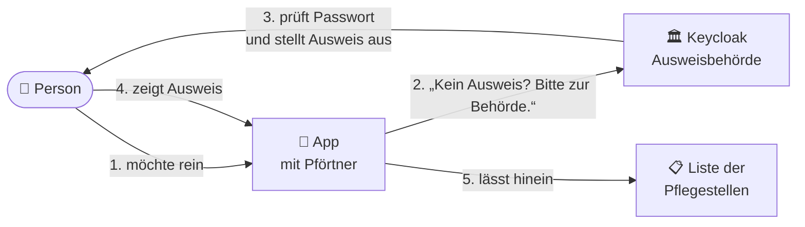
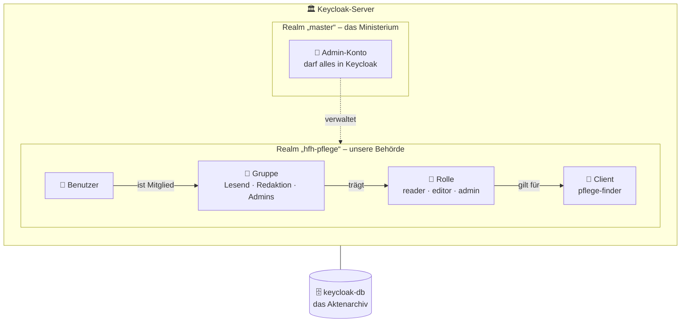
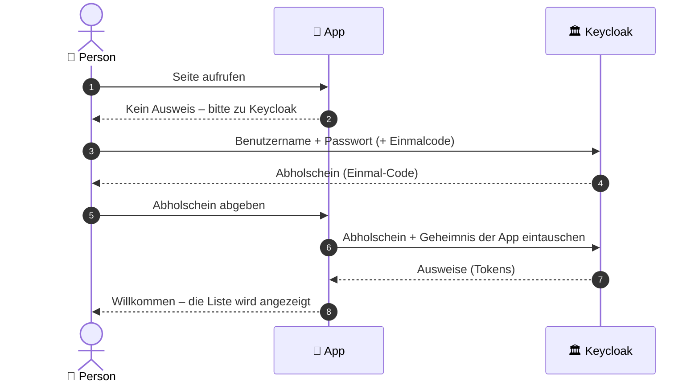
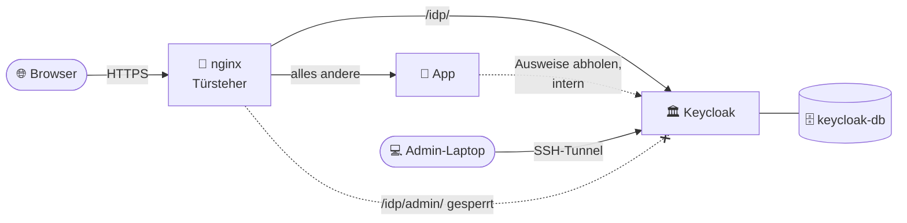
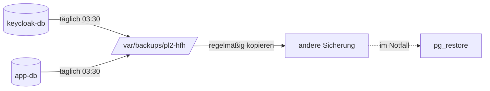

# Keycloak – die Ausweisbehörde unserer App

Dieses Dokument erklärt, was Keycloak ist, wie es funktioniert und wie wir es
im Pflegezentren-Finder einsetzen. Es richtet sich ausdrücklich auch an
Leserinnen und Leser **ohne** technischen Hintergrund. Fachbegriffe werden
beim ersten Auftauchen erklärt und stehen gesammelt im [Glossar](#15-glossar).

---

## 1. Keycloak in einem Bild

Stell dir vor, unsere App ist ein **Gebäude mit Pförtner**.

- Der Pförtner kennt keine Passwörter. Er lässt nur Menschen hinein, die einen
  **gültigen, gestempelten Ausweis** vorzeigen.
- Ausweise stellt eine eigene **Ausweisbehörde** aus: **Keycloak**. Dort sind
  alle Personen registriert, dort wird das Passwort geprüft, dort wird der
  Ausweis gestempelt.
- Wer ohne Ausweis kommt, wird vom Pförtner freundlich zur Behörde geschickt
  und kommt mit Ausweis zurück.



**Warum dieser Umweg?** Passwörter sicher speichern, Konten nach zu vielen
Fehlversuchen sperren, Zwei-Faktor-Anmeldung, Passwort zurücksetzen: Genau an
diesen Stellen entstehen sonst die meisten Sicherheitslücken. Keycloak ist eine
bewährte, kostenlose Open-Source-Software, die das alles fertig mitbringt. Unsere
App muss deshalb **keine einzige Zeile** Passwort-Logik enthalten.

---

## 2. Das Bildwörterbuch

Die Admin-Konsole von Keycloak benutzt englische Fachbegriffe. So lassen sie
sich übersetzen:

| Begriff in Keycloak | Im Bild | Bei uns |
|---|---|---|
| **Realm** | Eine eigenständige Behörde mit eigenen Akten und Regeln | `hfh-pflege` (für die App) und `master` (nur zum Verwalten von Keycloak) |
| **Client** | Ein Gebäude, das die Ausweise dieser Behörde akzeptiert | `pflege-finder` = unsere App |
| **User** (Benutzer) | Eine registrierte Person | jede Mitarbeiterin, jeder Mitarbeiter |
| **Group** (Gruppe) | Eine Abteilung; alle Mitglieder bekommen dieselben Rechte | `Lesend`, `Redaktion`, `Admins` |
| **Role** (Rolle) | Eine Zugangsberechtigung, die auf dem Ausweis steht | `reader`, `editor`, `admin` |
| **Token** | Der gestempelte Ausweis selbst | wird nach jedem Login ausgestellt |
| **Session** (Sitzung) | Wie lange der Ausweis gilt | höchstens 8 Stunden |
| **Identity Provider** | Eine Partnerbehörde, deren Ausweise anerkannt werden | geplant: Login mit HFH-Konto (Issue #52) |

---

## 3. Wie die Behörde aufgebaut ist



- **Der Realm `master`** ist nur für die Verwaltung da. Dort gehören **keine**
  normalen Nutzerinnen und Nutzer hinein.
- **Der Realm `hfh-pflege`** ist die Behörde für unsere App. Hier liegen alle
  Konten, Gruppen und Regeln.
- **Rechte werden über Gruppen vergeben**, nicht an jede Person einzeln. Neue
  Kolleginnen und Kollegen kommen einfach in die passende Gruppe.
- **Alles wird dauerhaft in einer eigenen Datenbank** (`keycloak-db`)
  gespeichert, getrennt von den Daten der Pflegestellen.

---

## 4. Die drei Ausweise (Tokens)

Nach einem erfolgreichen Login stellt Keycloak drei digital unterschriebene
Dokumente aus. Die Unterschrift kann niemand fälschen: Die App erkennt sofort,
ob ein Ausweis wirklich von unserer Behörde stammt.

| | Ausweis | Frage, die er beantwortet | Gültigkeit |
|---|---|---|---|
| 🪪 | **ID-Token** | „Wer bist du?“ (Name, E-Mail) | einmalig beim Login |
| 🎟️ | **Access-Token** | „Was darfst du?“ (Rollen) | 5 Minuten |
| 🔄 | **Refresh-Token** | „Bitte verlängern“, ohne erneutes Passwort | so lange wie die Sitzung |

Unsere App liest Name, E-Mail und Rollen aus und merkt sie sich in einem
signierten Cookie für höchstens 8 Stunden.

---

## 5. Der Login Schritt für Schritt



Das Besondere an diesem Ablauf:

- **Das Passwort sieht nur Keycloak**, niemals die App.
- Der Browser bekommt nur einen **wertlosen Abholschein**. Den echten Ausweis
  holt die App selbst ab, direkt bei Keycloak und mit einem nur ihr bekannten
  Geheimnis (dem *Client-Secret*).
- Zusätzlich sendet die App bei jedem Login ein Einmal-Geheimnis mit (**PKCE**).
  Selbst ein abgefangener Abholschein ist damit nutzlos. Keycloak **verlangt**
  das inzwischen: Eine Login-Anfrage ohne PKCE wird abgelehnt
  (*Clients → pflege-finder → Settings → Capability config → Require PKCE*).

---

## 6. Wer darf was? Rollen und Gruppen

| Gruppe | Rolle auf dem Ausweis | Darf in der App |
|---|---|---|
| **Lesend** | `reader` | Liste ansehen, filtern, Sammel-Mail öffnen |
| **Redaktion** | `editor` | zusätzlich Stellen anlegen, ändern, deaktivieren |
| **Admins** | `admin` | dieselben Rechte wie Redaktion |

Wichtig:

- Wer in **keiner** Gruppe ist, kann sich zwar anmelden, sieht aber keine Daten
  (die App antwortet mit „keine Berechtigung“).
- Die Rolle `admin` in der App ist **nicht** dasselbe wie ein Admin-Konto in
  Keycloak. Sie gibt keinerlei Rechte in der Keycloak-Verwaltung.
- Ändert sich die Gruppe einer Person, wirkt das erst nach erneutem Anmelden.

---

## 7. Die Schutzmechanismen

Diese Regeln gelten im Realm `hfh-pflege`:

| Schutz | Was er tut | Bild |
|---|---|---|
| **Sperre nach Fehlversuchen** | Nach 5 falschen Passwörtern wird das Konto vorübergehend gesperrt, mit wachsender Wartezeit (max. 15 Minuten) | Der Schalter schließt nach zu vielen Fehlversuchen |
| **Passwort-Regeln** | Mindestens 12 Zeichen, nicht der Benutzername, nicht die E-Mail, keins der letzten 3 Passwörter | Keine Schlüssel, die jeder nachmachen kann |
| **Einmalcode (Zwei-Faktor)** | Neue Konten richten beim ersten Login eine Authenticator-App ein | Ein zweites Schloss: Passwort allein reicht nicht |
| **Begrenzte Sitzungen** | Nach 30 Minuten Untätigkeit oder spätestens 8 Stunden ist eine neue Anmeldung nötig | Der Ausweis läuft ab |
| **Audit-Protokoll** | Anmeldungen, Fehlversuche und Admin-Änderungen werden 30 Tage gespeichert | Das Besucherbuch der Behörde |
| **Keine Selbstregistrierung** | Konten legt nur ein Admin an | Kein Ausweis ohne Antrag |
| **Verwaltung nur über Tunnel** | Die Admin-Konsole ist aus dem Internet nicht erreichbar | Das Ministerium hat keinen Publikumseingang |

„Passwort vergessen“ ist bewusst ausgeschaltet, solange kein E-Mail-Versand
eingerichtet ist (Issue #53). Bis dahin setzt ein Admin das Passwort zurück.

---

## 8. Wie Keycloak bei uns läuft



- Keycloak läuft als eigener Container neben der App, erreichbar unter
  `https://projekthfh.tech/idp/`.
- Davor steht **nginx**: Er verschlüsselt die Verbindung (HTTPS) und sperrt den
  Verwaltungsbereich nach außen.
- Die **Admin-Konsole** erreicht man nur über einen SSH-Tunnel:

  ```bash
  ssh -L 8080:localhost:8080 <benutzer>@<server>
  # dann im Browser: http://localhost:8080/idp/admin/
  ```

---

## 9. Die wichtigste Regel: „nur beim allerersten Start“

In diesem Ordner liegen zwei Dateien, die dieselben Einstellungen beschreiben:

| Datei | Wann sie wirkt |
|---|---|
| `realm-export.json` | **Nur beim allerersten Start**, wenn die Keycloak-Datenbank noch leer ist. Danach wird sie ignoriert. |
| `configure.sh` | Jederzeit. Überträgt die Einstellungen auf eine **bestehende** Keycloak-Installation und kann beliebig oft laufen. |

Im Bild: Die Realm-Datei ist das **Gründungsdokument** der Behörde. Ist die
Behörde einmal gegründet, ändert ein neues Gründungsdokument nichts mehr.
Änderungen laufen danach über die Verwaltung (Admin-Konsole) oder das Skript.

```bash
cd /opt/pl2-hfh
./keycloak/configure.sh                 # fragt das Admin-Passwort ab
./keycloak/configure.sh --delete-demo   # zusätzlich ein altes Demo-Konto entfernen
./keycloak/configure.sh --enforce-pkce  # zusätzlich PKCE erzwingen
```

Das Skript setzt Login-Schutz, Passwort-Regeln, Sprache, Sitzungsdauer,
Audit-Protokoll, Einmalcode-Pflicht, Rollen, Gruppen, das Login-Theme `hfh`
und den Login-Schutz im Realm `master`. Am Ende zeigt es die gesetzten Werte an.

Meldet `kcadm.sh` „No server specified“, ist die Anmeldung im Container
verloren gegangen (zum Beispiel nach einem Neustart). Dann neu anmelden:

```bash
docker compose exec keycloak /opt/keycloak/bin/kcadm.sh config credentials \
  --server http://localhost:8080/idp --realm master --user admin
```

Ebenfalls nur beim ersten Start übernommen: das Admin-Passwort und das
Datenbank-Passwort aus der `.env`. Werden sie später in der `.env` geändert,
ändert sich in Keycloak **nichts**, und Keycloak findet im schlimmsten Fall
seine eigene Datenbank nicht mehr.

**Nie im Repository:** Passwörter, das Client-Secret und echte Benutzerkonten.

---

## 10. Häufige Aufgaben in der Admin-Konsole

Alle Wege beziehen sich auf den Realm **`hfh-pflege`** (oben links auswählen).

| Aufgabe | Weg |
|---|---|
| **Person anlegen** | *Users → Add user* → Benutzername, E-Mail, Name → *Create* → *Credentials → Set password* (Haken „Temporary“ an) |
| **Rechte vergeben** | *Users → Person → Groups → Join group* → `Lesend`, `Redaktion` oder `Admins` |
| **Passwort zurücksetzen** | *Users → Person → Credentials → Reset password* (Haken „Temporary“ an) |
| **Konto sperren** | *Users → Person* → Schalter *Enabled* aus |
| **Handy mit Authenticator verloren** | *Users → Person → Credentials* → Eintrag „OTP“ löschen; beim nächsten Login wird neu eingerichtet |
| **Gesperrtes Konto nach Fehlversuchen entsperren** | *Users → Person* → Hinweis „temporarily locked“ → entsperren |
| **Wer hat sich wann angemeldet?** | *Events → User events* |
| **Wer hat was geändert?** | *Events → Admin events* |

---

## 11. Backups und Wiederherstellung

Die Datenbanken `app-db/pflegedb` und `keycloak-db/keycloak` werden logisch mit
`pg_dump -Fc -Z 9` gesichert. Das Custom-Format wird mit `pg_restore` gelesen
und ist portabler als ein Docker-Volume-Snapshot. Das Skript stoppt keine
Container und enthält keine Datenbank-Passwörter oder sonstigen Secrets.



| Frage | Antwort |
|---|---|
| **Was wird gesichert?** | Beide Datenbanken einzeln: `pflegedb-<UTC-Zeit>.dump` und `keycloak-<UTC-Zeit>.dump` |
| **Wann?** | Täglich um 03:30 Uhr; zusätzlich von Hand vor Updates |
| **Wo?** | `/var/backups/pl2-hfh`, Standard-Aufbewahrung 14 Tage |
| **Nicht im Scope** | Keine `.env`-Secrets, Zertifikate, Volume-Dateiebenen oder Verschlüsselung |
| **Dateirechte** | Verzeichnis und Dump-Dateien erhalten Modus `700` bzw. `600` |

### Einrichtung und tägliche Ausführung

Auf dem Server muss das Repository unter `/opt/pl2-hfh` liegen. Beide Datenbank-
Container müssen laufen und das Keycloak-Profil muss aktiviert sein:

```bash
cd /opt/pl2-hfh
docker compose --profile sso up -d app-db keycloak-db
chmod 700 scripts/backup_db.sh
./scripts/backup_db.sh
ls -lh /var/backups/pl2-hfh
```

Für einen eigenen Aufbewahrungszeitraum kann die Variable `RETENTION_DAYS`
beim Aufruf gesetzt werden; der Default ist 14 Tage:

```text
30 3 * * * cd /opt/pl2-hfh && ./scripts/backup_db.sh >> /var/log/pl2-backup.log 2>&1
```

Die Zeile kann als Root oder als ein Benutzer mit Docker-Zugriff in `crontab -e`
eingetragen werden. Der gleichzeitige Start wird mit einem Lock verhindert.
Eine Kopie außerhalb des Servers sollte separat geplant werden; sie ist bewusst
nicht Bestandteil des Repository-Skripts:

```bash
scp '<benutzer>@<server>:/var/backups/pl2-hfh/*.dump' ~/Backups/pl2-hfh/
```

### Probe: Restore in Testdatenbanken

Restore-Probe am 19.11.2026 durchgeführt: Die erzeugten Dumps beider Datenbanken
wurden mit `pg_restore --clean --if-exists --no-owner --no-privileges` in jeweils
frische Testdatenbanken eingespielt. Die App-Wiederherstellung ergab 4092 Einträge
in `centers`; der Keycloak-Dump ließ sich ebenfalls vollständig in die leere
Testdatenbank einlesen. Anschließend wurden beide Testdatenbanken wieder gelöscht.
Die lokalen Produktivdatenbanken blieben unberührt.

```bash
cd /opt/pl2-hfh
BACKUP=/var/backups/pl2-hfh
APP_DUMP=$(ls -t "$BACKUP"/pflegedb-*.dump | head -n1)
KC_DUMP=$(ls -t "$BACKUP"/keycloak-*.dump | head -n1)

docker compose exec keycloak-db createdb -U keycloak keycloak_restore_test
docker compose exec -T keycloak-db pg_restore --clean --if-exists --no-owner --no-privileges \
  -U keycloak -d keycloak_restore_test < "$KC_DUMP"
docker compose exec keycloak-db psql -U keycloak -d keycloak_restore_test \
  -c 'SELECT count(*) AS user_count FROM user_entity;' \
  -c 'SELECT count(*) AS realm_count FROM realm;'
docker compose exec keycloak-db dropdb -U keycloak keycloak_restore_test

# Analog für die App-Datenbank:
docker compose exec app-db createdb -U pl2 pflegedb_restore_test
docker compose exec -T app-db pg_restore --clean --if-exists --no-owner --no-privileges \
  -U pl2 -d pflegedb_restore_test < "$APP_DUMP"
docker compose exec app-db psql -U pl2 -d pflegedb_restore_test \
  -c 'SELECT count(*) AS center_count FROM centers;'
docker compose exec app-db dropdb -U pl2 pflegedb_restore_test
```

Die tatsächlichen Tabellen- und Sichtnamen können mit `pg_restore --list`
geprüft werden. Bei Abweichungen den Restore nach den Produktivtabellen
des jeweiligen Backups anpassen.

### Restore der App-Datenbank

Nur bei Datenverlust durchführen. Alle Änderungen nach dem gewählten
Backup-Zeitpunkt gehen dabei verloren:

```bash
cd /opt/pl2-hfh
APP_DUMP=/var/backups/pl2-hfh/pflegedb-<UTC-Zeit>.dump
docker compose stop app
docker compose exec app-db dropdb -U pl2 pflegedb
docker compose exec app-db createdb -U pl2 pflegedb
docker compose exec -T app-db pg_restore --clean --if-exists --no-owner --no-privileges \
  -U pl2 -d pflegedb < "$APP_DUMP"
docker compose up -d app
```

### Restore der Keycloak-Datenbank

```bash
cd /opt/pl2-hfh
KC_DUMP=/var/backups/pl2-hfh/keycloak-<UTC-Zeit>.dump
docker compose stop keycloak
docker compose exec keycloak-db dropdb -U keycloak keycloak
docker compose exec keycloak-db createdb -U keycloak keycloak
docker compose exec -T keycloak-db pg_restore --clean --if-exists --no-owner --no-privileges \
  -U keycloak -d keycloak < "$KC_DUMP"
docker compose --profile sso up -d keycloak
```

Danach Login der App und die Keycloak-Admin-Konsole prüfen. Das Datenbank-
Passwort aus `.env` muss zum wiederhergestellten Datenbankinhalt passen.

---

## 12. Aussehen und Gesundheit

### Eigenes Login-Theme `hfh`

Die Login-Seite trägt die Farben der App (Ordner `keycloak/themes/hfh/`). Das
Theme ändert nur das Aussehen per CSS, Aufbau und Logik bleiben die von
Keycloak. Im Bild: Die Behörde bekommt einen neuen Anstrich, das Gebäude bleibt.

| Datei | Zweck |
|---|---|
| `themes/hfh/login/theme.properties` | erbt vom Standard-Theme `keycloak.v2` |
| `themes/hfh/login/resources/css/hfh.css` | Farben, Formen, Logo-Badge |
| `themes/hfh/login/messages/messages_de.properties` | eigene deutsche Texte |

- Aktiv geschaltet über *Realm settings → Themes → Login theme: `hfh`* (oder
  `configure.sh`).
- Keycloak merkt sich Themes im Produktivbetrieb. Nach einer Änderung am Theme
  Keycloak neu starten: `docker compose --profile sso restart keycloak`.

### Gesundheitscheck

Docker fragt Keycloak alle 30 Sekunden, ob es bereit ist (`/idp/health/ready`
auf dem internen Port 9000, von außen nicht erreichbar).

```bash
docker compose ps keycloak    # "(healthy)" = alles in Ordnung
```

Steht dort `(unhealthy)` oder `Restarting`, hilft Abschnitt 14.

---

## 13. Updates von Keycloak

Neue Keycloak-Versionen schlägt **Dependabot** automatisch als Pull Request vor.
Vor dem Mergen:

1. **Backup ziehen** (Abschnitt 11, Schritt 2).
2. Die Versionshinweise lesen: Bei großen Versionssprüngen (z. B. 26 → 27)
   ändern sich manchmal Einstellungen.
3. Mergen, Deploy abwarten, dann prüfen: `docker compose ps keycloak` zeigt
   `(healthy)`, Login in der App funktioniert, die Login-Seite sieht aus wie gewohnt.

Hinweis für später: Die Variablen `KEYCLOAK_ADMIN` und `KEYCLOAK_ADMIN_PASSWORD`
heißen seit Keycloak 26 eigentlich `KC_BOOTSTRAP_ADMIN_USERNAME` und
`KC_BOOTSTRAP_ADMIN_PASSWORD`. Die alten Namen funktionieren noch, sollten aber
vor einem künftigen Major-Update umbenannt werden.

---

## 14. Wenn etwas schiefgeht

| Anzeichen | Ursache | Lösung |
|---|---|---|
| Keycloak startet ständig neu, Log: `password authentication failed for user "keycloak"` | `KEYCLOAK_DB_PASSWORD` in der `.env` passt nicht zur Datenbank | Passwort in der Datenbank an die `.env` angleichen (siehe unten) |
| App zeigt „keine Berechtigung“ oder eine leere Liste | Konto ist in keiner Gruppe | *Users → Person → Groups → Join group*, dann ab- und wieder anmelden |
| Admin-Konsole springt auf `https://projekthfh.tech/idp/admin/…` und zeigt 404 | Realm `master` leitet auf die öffentliche Adresse um | `frontendUrl` des Realms `master` auf den Tunnel setzen (README im Hauptverzeichnis, Abschnitt 8, Schritt 4) |
| `kcadm.sh`: „No server specified“ | Anmeldung im Container verloren | `kcadm.sh config credentials …` (Abschnitt 9) |
| Login-Seite zeigt „Missing parameter: code_challenge_method“ | Ein Client ohne PKCE versucht sich anzumelden | Bei unserer App nicht zu erwarten; nur bei neuen Clients PKCE einbauen |
| Konto gesperrt nach Fehlversuchen | Schutz gegen Passwort-Raten | Wartezeit abwarten oder in der Konsole entsperren (Abschnitt 10) |

**Datenbank-Passwort angleichen** (Keycloak findet seine Datenbank nicht):

```bash
cd /opt/pl2-hfh
PW=$(grep '^KEYCLOAK_DB_PASSWORD=' .env | tail -n1 | cut -d= -f2-)
echo "ALTER USER keycloak PASSWORD :'pw';" | \
  docker exec -i pl2-hfh-keycloak-db-1 psql -U keycloak -d keycloak -v ON_ERROR_STOP=1 -v pw="$PW"
unset PW
docker compose --profile sso up -d keycloak
```

Das klappt, weil sich Befehle **innerhalb** des Datenbank-Containers ohne
Passwort anmelden dürfen. Danach den Wert im Passwortmanager festhalten.

**Wo welche Geheimnisse liegen:**

| Geheimnis | Ort | Zusätzlich sichern in |
|---|---|---|
| Admin-Passwort, `KEYCLOAK_DB_PASSWORD`, `APP_DB_PASSWORD`, `SECRET_KEY` | `/opt/pl2-hfh/.env` | Passwortmanager |
| Client-Secret (`OIDC_CLIENT_SECRET`) | `.env` und Keycloak | Passwortmanager |
| Persönliche Admin-Konten | Keycloak (Realm `master`) | jede Person selbst, mit Einmalcode |

---

## 15. Glossar

| Begriff | Erklärung |
|---|---|
| **Admin-Konsole** | Die Verwaltungsoberfläche von Keycloak im Browser |
| **Audit / Events** | Protokoll von Anmeldungen und Änderungen |
| **Backup / Dump** | Eine Sicherungskopie der Datenbank als Datei, aus der sie wiederhergestellt werden kann |
| **Cronjob** | Ein Auftrag, den der Server automatisch zu festen Zeiten ausführt |
| **Healthcheck** | Regelmäßige automatische Frage „Bist du bereit?“ an einen Dienst |
| **Brute-Force-Schutz** | Sperre gegen massenhaftes Passwort-Raten |
| **Claim** | Ein einzelner Eintrag auf dem Ausweis, z. B. `email` oder `roles` |
| **Client** | Eine Anwendung, die Keycloak-Logins nutzt (bei uns `pflege-finder`) |
| **Client-Secret** | Das Passwort der App gegenüber Keycloak |
| **Identity Provider** | Ein fremder Login-Dienst, dem Keycloak vertraut (z. B. Microsoft-Konto der HFH) |
| **MFA / OTP** | Mehr-Faktor-Anmeldung; OTP ist ein 6-stelliger Einmalcode aus einer App |
| **OpenID Connect (OIDC)** | Der Standard, nach dem App und Keycloak miteinander sprechen |
| **PKCE** | Ein Einmal-Geheimnis pro Login, das abgefangene Codes wertlos macht |
| **Realm** | Ein abgeschlossener Bereich mit eigenen Benutzern und Regeln |
| **Required Action** | Eine Aufgabe, die beim nächsten Login erzwungen wird (z. B. Passwort ändern) |
| **Session** | Die Zeitspanne, in der man angemeldet bleibt |
| **SSO (Single Sign-On)** | Einmal anmelden, in mehreren Anwendungen eingeloggt sein |
| **Theme** | Das Aussehen der Login-Seite (Farben, Schrift, Logo) |
| **Token** | Ein digital unterschriebener Ausweis |

---

## 16. Weiterführend

- Offizielle Dokumentation: <https://www.keycloak.org/documentation>
